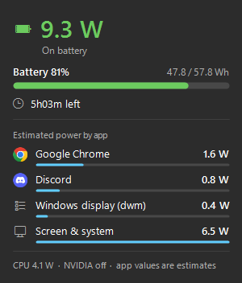
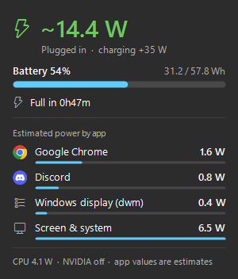

# Battery Power Meter

A tiny Windows tray app that shows your laptop's **live power draw in watts** next to the clock, with a hover panel for battery details and per-app usage.

| On battery | Plugged in |
|---|---|
|  |  |

## Why

I made this with Claude, using Opus 5.5. I needed it, and there weren't any good apps that made this easy.

## Features

- Live watts in the taskbar, colored green / orange / red (under 15 W, 15–25 W, over 25 W)
- Hover panel with battery level, capacity in Wh, and time left or time to full (3-minute average)
- Estimated power per app, with app icons
- Works while charging, using the CPU's own power sensor (Intel)
- Follows the Windows light/dark theme
- Very light: about 0.1–0.2% CPU

## Install

1. Download this repo (**Code → Download ZIP**) and extract it.
2. Double-click `install.cmd`.

No admin rights needed. It installs to `%LOCALAPPDATA%\PowerMeter`, adds a desktop shortcut, and starts with Windows.

To remove it, double-click `uninstall.cmd`.

## Notes

- Windows 10/11 laptop with a battery.
- Per-app numbers are **estimates**: Windows reports only the total, so the measured CPU power is split by each app's CPU and GPU activity.
- While plugged in, usage = measured CPU power + NVIDIA GPU (if awake) + the rest of the laptop. The meter learns that last part while on battery. Without an Intel CPU power sensor (e.g. on AMD), the plugged-in view shows charging info only.
- Time left leaves out the last 2%, where Windows hibernates the laptop.

## License

MIT
